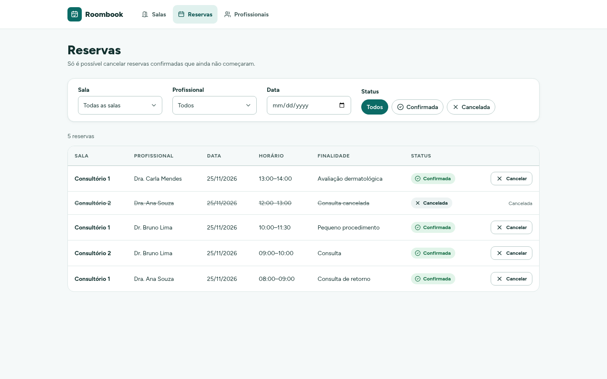
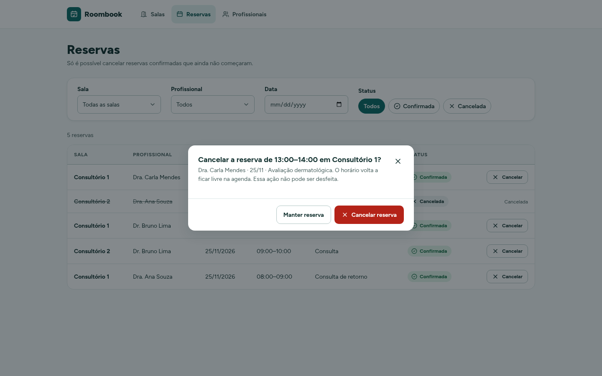
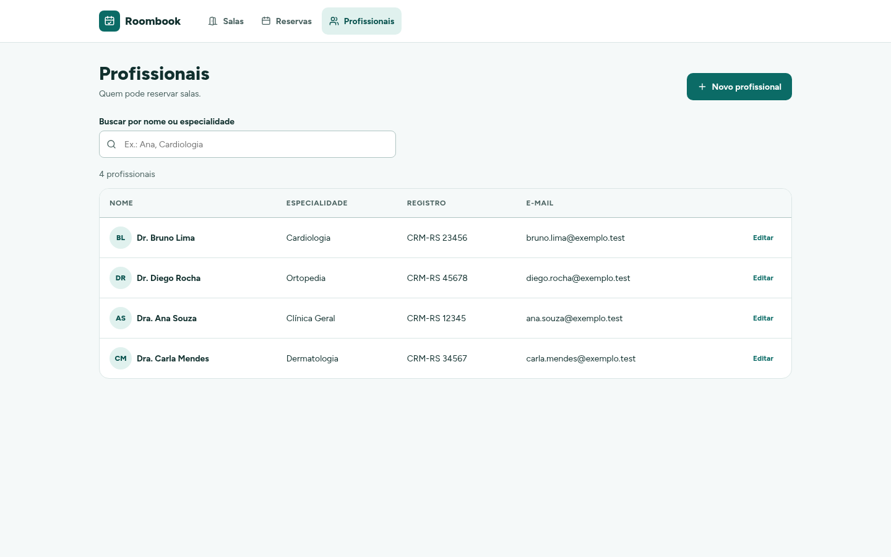
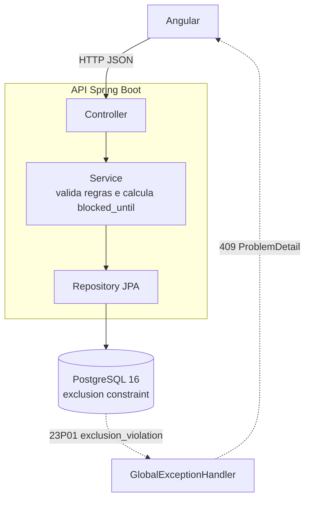
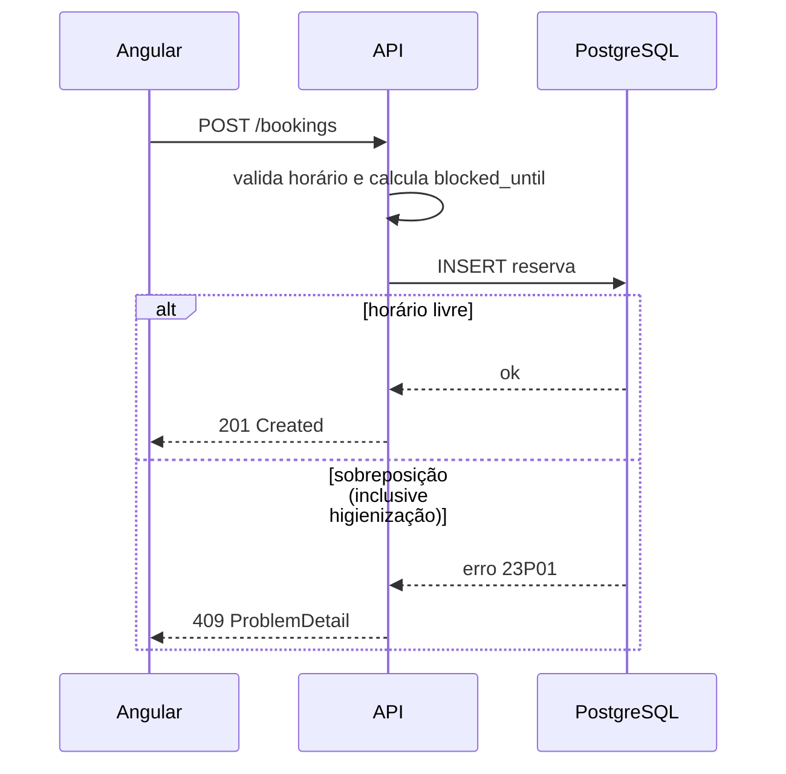
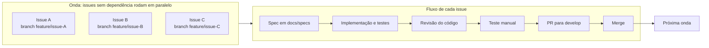

# Roombook

Reserva de salas clínicas com higienização automática entre uma reserva e outra.


## O problema

Numa clínica, consultórios, salas de exame e de procedimento são disputados por vários profissionais. Uma sala não pode ser usada logo depois de outra reserva: ela precisa de um intervalo de higienização (20 min num consultório, 10 min numa sala de exame, e assim por diante, definido por sala).

O Roombook trata esse intervalo como parte da reserva. Ao reservar das 07:00 às 08:00 numa sala com 20 min de higienização, a sala fica bloqueada até 08:20. Nenhuma outra reserva entra nessa janela, nem por duas pessoas clicando ao mesmo tempo.

## Stack

| Camada | Tecnologia |
|---|---|
| API | Spring Boot 4, Java 21, Spring Data JPA, springdoc-openapi |
| Banco | PostgreSQL 16, migrations com Flyway |
| Front | Angular 21 (componentes standalone, signals) |
| Testes | JUnit 5, Mockito, Testcontainers |
| Empacotamento | Docker Compose (banco + API) |

## Telas

| | |
|---|---|
| **Salas**: filtros por tipo e status; sala em manutenção fica sinalizada.  | **Agenda do dia**: blocos de 30 min (livre, ocupado, higienização).  |
| **Nova reserva**: mostra até quando a sala fica bloqueada.  | **Reservas**: filtros por sala, profissional, data e status, com paginação.  |
| **Cancelar reserva**: confirmação antes de liberar o horário.  | **Profissionais**: lista, busca e cadastro.  |

No celular as telas se reorganizam, com navegação inferior e a agenda em uma coluna:

 

## Como rodar

Pré-requisitos: Docker com Compose, Node 22 e npm. (Java 21 só é preciso para rodar a API fora do Docker ou os testes.)

### 1. Banco e API (Docker Compose)

```bash
cp .env.example .env        # troque POSTGRES_PASSWORD
docker compose up -d --build
```

O `docker-compose.yml` sobe o PostgreSQL e a API com o perfil `dev`, que além das migrations carrega dados de exemplo (salas e profissionais com e-mails `@exemplo.test`, sem login).

Variáveis (no `.env`):

| Variável | Padrão | Para quê |
|---|---|---|
| `POSTGRES_PASSWORD` | sem padrão, obrigatória | senha do banco |
| `POSTGRES_DB`, `POSTGRES_USER` | `roombook` | banco e usuário |
| `DB_PORT` | `5432` | porta do banco no host (mude se estiver ocupada) |
| `SERVER_PORT` | `8080` | porta da API no host |
| `CORS_ALLOWED_ORIGINS` | `http://localhost:4200` | origem do front liberada no CORS |

Com a API no ar: `http://localhost:8080/swagger-ui/index.html` (documentação) e `http://localhost:8080/rooms`.

### 2. Front (Angular)

```bash
cd frontend
npm install --legacy-peer-deps
npm run start:local
```

Abre em `http://localhost:4200`. O script `start:local` gera `src/environments/environment.local.ts` apontando para `http://localhost:$API_PORT` (padrão 8080).

Variáveis do front:

| Variável | Padrão | Para quê |
|---|---|---|
| `FRONT_PORT` | `4200` | porta do `ng serve` |
| `API_PORT` | `8080` | porta da API (use o mesmo valor de `SERVER_PORT`) |
| `API_URL` | `http://localhost:$API_PORT` | URL completa da API, se não for local |

Se mudar a porta do front, libere-a no CORS da API: `CORS_ALLOWED_ORIGINS=http://localhost:4223` no `.env`. Exemplo com tudo em portas alternativas:

```bash
# .env: DB_PORT=5433, SERVER_PORT=8081, CORS_ALLOWED_ORIGINS=http://localhost:4223
docker compose up -d --build
cd frontend && API_PORT=8081 FRONT_PORT=4223 npm run start:local
```

### Sem Docker para a API

Suba só o banco (`docker compose up -d db`) e rode a API na máquina:

```bash
SPRING_PROFILES_ACTIVE=dev \
SPRING_DATASOURCE_URL=jdbc:postgresql://localhost:5432/roombook \
SPRING_DATASOURCE_USERNAME=roombook \
SPRING_DATASOURCE_PASSWORD=<a senha do .env> \
FRONT_PORT=4200 ./mvnw spring-boot:run
```

Nesse modo o CORS libera `http://localhost:$FRONT_PORT` (padrão 4200).

### Testes

Os testes `@SpringBootTest` usam o banco do `application.yaml`, que lê `POSTGRES_PASSWORD`, `DB_PORT` etc. do ambiente. O `mvnw` não lê o `.env` sozinho, então carregue-o antes:

```bash
docker compose up -d db
set -a; . ./.env; set +a; ./mvnw test   # API (os de Testcontainers também precisam de Docker)
cd frontend && npx ng test --watch=false  # front
```

## Deploy no Railway (ambiente de teste)

Três serviços no mesmo projeto: **Postgres**, **api** e **front**. A API roda com o perfil `dev`, então mantém os dados de exemplo (salas e profissionais). Nada de segredo no repositório: as credenciais vêm das variáveis do plugin Postgres.

1. **Postgres**: adicione o plugin de banco do Railway.
2. **api** (repositório, root directory `/`, usa o `Dockerfile` da raiz). Variáveis:

   | Variável | Valor |
   |---|---|
   | `SPRING_PROFILES_ACTIVE` | `dev` |
   | `SPRING_DATASOURCE_URL` | `jdbc:postgresql://${{Postgres.PGHOST}}:${{Postgres.PGPORT}}/${{Postgres.PGDATABASE}}` |
   | `SPRING_DATASOURCE_USERNAME` | `${{Postgres.PGUSER}}` |
   | `SPRING_DATASOURCE_PASSWORD` | `${{Postgres.PGPASSWORD}}` |
   | `CORS_ALLOWED_ORIGINS` | URL pública do front (passo 4) |

   O Railway injeta `PORT` e a API o respeita (sem `PORT`, usa `SERVER_PORT`, depois `8080`). Healthcheck path: `/actuator/health`. Gere um domínio público e anote a URL.
3. **front** (root directory `frontend`, usa `frontend/Dockerfile`). Variável de build: `API_URL` = URL pública da API do passo 2. Ela entra no bundle durante o `docker build`, então mudar o valor exige novo deploy do front. Sem `API_URL` o build aponta para `http://localhost:8080`. Gere um domínio público.
4. Volte na **api** e defina `CORS_ALLOWED_ORIGINS` com a URL do front (sem barra no final); ela reinicia sozinha.

Ordem: Postgres, api, front (com a URL da api), depois o CORS da api (com a URL do front).

Teste local das imagens:

```bash
docker build --build-arg API_URL=https://api.exemplo.test -t roombook-front frontend/
docker run --rm -e PORT=8081 -p 8081:8081 roombook-front
```

## Arquitetura



O service faz uma checagem prévia só para dar uma mensagem amigável. Quem garante a regra, mesmo com requisições simultâneas, é a *exclusion constraint* do banco.



## Decisões técnicas

**Sobreposição resolvida no banco, não na aplicação.** Verificar "tem conflito?" e depois inserir tem corrida: duas requisições simultâneas passam na checagem. A tabela `bookings` tem uma *exclusion constraint*:

```sql
EXCLUDE USING gist (
    room_id WITH =,
    tstzrange(start_time, blocked_until) WITH &&
) WHERE (status = 'CONFIRMED');
```

`blocked_until` é o fim da reserva mais a higienização da sala, calculado no servidor (o cliente nunca o envia). A faixa que conta é `start_time` até `blocked_until`, então a higienização também bloqueia. Reservas canceladas ficam fora do `WHERE` e liberam o horário. A violação vira `409` na API. Detalhes em [`docs/specs/sobreposicao-higienizacao.md`](docs/specs/sobreposicao-higienizacao.md).

**N+1 na listagem de reservas.** Cada linha mostra nome da sala e do profissional; carregar `room` e `professional` de forma preguiçosa disparava uma query por linha (7 statements para uma página de 5 reservas). O `@EntityGraph(attributePaths = {"room", "professional"})` em `BookingRepository` traz tudo num join e o teste `BookingListTest` agora exige no máximo 2 statements (a página e a contagem).

**Erros em `ProblemDetail`, em português.** Um `GlobalExceptionHandler` converte regras de negócio (409), entrada inválida (400) e não encontrado (404) no formato RFC 9457, com a mensagem pronta para o front mostrar:

```json
{ "title": "Conflict", "status": 409, "detail": "A sala já está reservada ou em higienização nesse horário", "instance": "/bookings" }
```

**Sem dados de paciente.** O sistema reserva salas, não atendimentos: não existe entidade de paciente. A reserva guarda só o profissional, a sala, o horário e uma finalidade em texto livre. Isso mantém o projeto fora do escopo de dados sensíveis de saúde; a finalidade não deve receber nomes de pacientes.

**Testcontainers para o que depende do Postgres.** A constraint usa `tstzrange` e `btree_gist`, que H2 não tem. O `BookingOverlapConstraintTest` sobe um PostgreSQL 16 real e prova que a constraint rejeita sobreposições, inclusive dentro da janela de higienização.

**Horários em UTC na API, fuso da clínica no front.** A API trafega `Instant`; o horário comercial e a exibição usam o fuso da clínica (-03:00).

## Como foi desenvolvido

O projeto foi quebrado em issues pequenas do GitHub e resolvido em ondas paralelas: as issues sem dependência entre si rodavam ao mesmo tempo, cada uma na sua branch (`feature/issue-N`, a partir de `develop`) e com banco e portas próprios, para não haver conflito.

O fluxo de cada issue:

1. **Spec primeiro.** Regras de negócio e critérios de aceite escritos em [`docs/specs`](docs/specs) (a partir de um template) antes do código.
2. **Implementação com testes**, no menor escopo que atende a issue.
3. **Revisão do código** e **teste manual** da funcionalidade rodando (API com `curl`, telas abertas ao lado do mockup em [`docs/design`](docs/design/direcao-a), no desktop e no celular) antes de abrir o PR.
4. **PR para `develop`** com resumo e casos testados; merge só depois da validação.



Agentes de IA foram usados como ferramenta de implementação e revisão dentro desse processo. As decisões de produto, as specs e a validação final são humanas, e os commits e PRs são descritivos, sem atribuição de autoria a ferramentas.

## Estrutura

```
src/                API Spring Boot (controller, service, repository, exception)
src/main/resources/db/migration   migrations Flyway (versão por timestamp)
src/main/resources/db/seed-dev    dados de exemplo (só perfil dev)
frontend/           app Angular
docs/specs          specs por funcionalidade
docs/design         mockups
docs/screenshots    prints usados neste README
```
