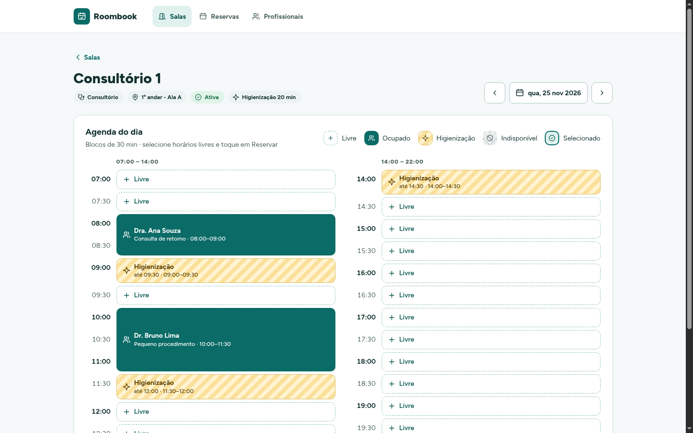
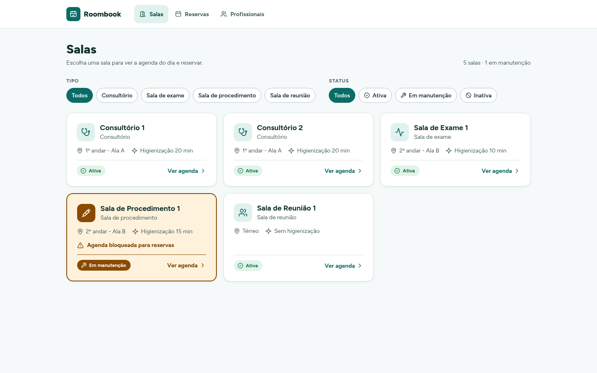
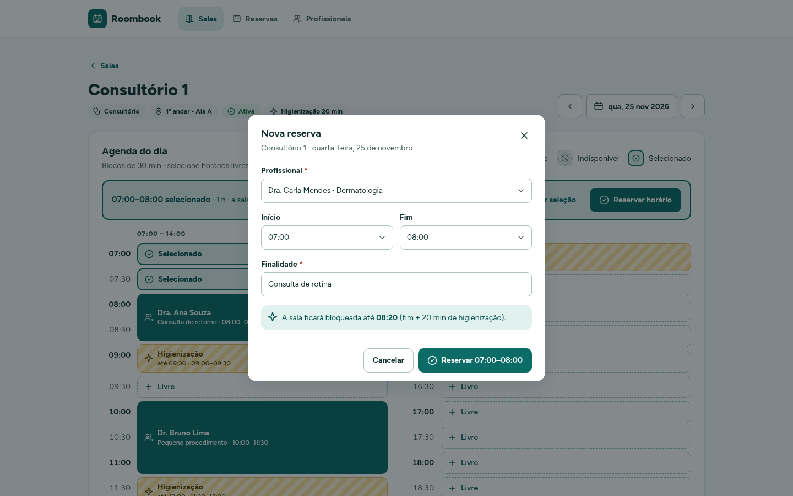
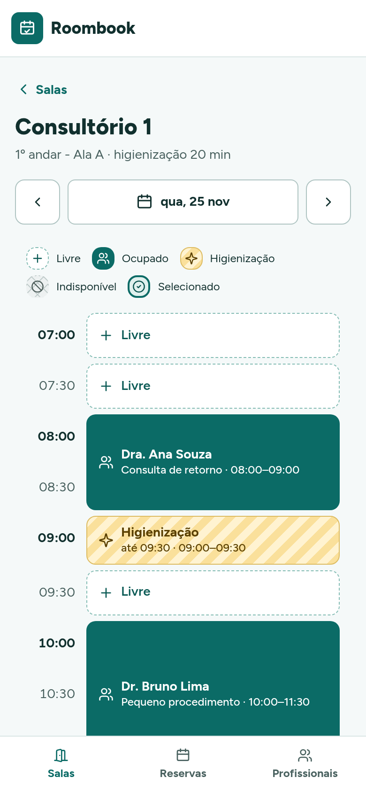
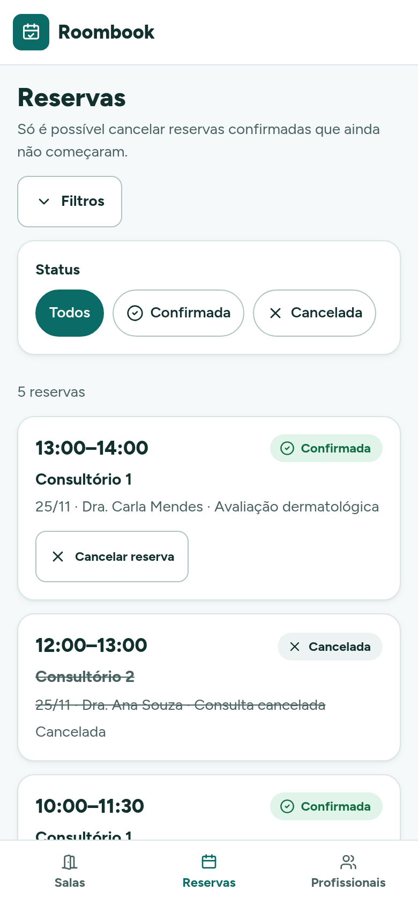
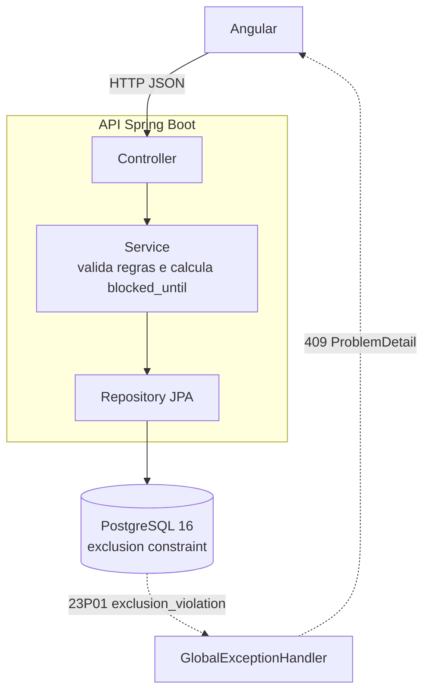

# Roombook

Reserva de salas clínicas com higienização automática entre uma reserva e outra.



## O problema

Numa clínica, consultórios, salas de exame e de procedimento são disputados por vários profissionais. Uma sala não pode ser usada logo depois de outra reserva: ela precisa de um intervalo de higienização (20 min num consultório, 10 min numa sala de exame, e assim por diante, definido por sala).

O Roombook trata esse intervalo como parte da reserva. Ao reservar das 07:00 às 08:00 numa sala com 20 min de higienização, a sala fica bloqueada até 08:20. Nenhuma outra reserva entra nessa janela, nem por duas pessoas clicando ao mesmo tempo.

## Stack

| Camada | Tecnologia |
|---|---|
| API | Spring Boot 4, Java 21, Spring Data JPA, springdoc-openapi |
| Banco | PostgreSQL 16, migrations com Flyway |
| Front | Angular 21 (componentes standalone, signals) |
| Testes | JUnit 5, Mockito, Testcontainers |
| Empacotamento | Docker Compose (banco + API) |

## Telas

| | |
|---|---|
| **Salas**: filtros por tipo e status; sala em manutenção fica sinalizada.  | **Agenda do dia**: blocos de 30 min (livre, ocupado, higienização).  |
| **Nova reserva**: mostra até quando a sala fica bloqueada.  | **Reservas**: filtros por sala, profissional, data e status, com paginação.  |
| **Cancelar reserva**: confirmação antes de liberar o horário.  | **Profissionais**: lista, busca e cadastro.  |

No celular as telas se reorganizam, com navegação inferior e a agenda em uma coluna:

 

## Como rodar

Pré-requisitos: Docker com Compose, Node 22 e npm. (Java 21 só para rodar a API fora do Docker ou os testes.)

```bash
cp .env.example .env        # troque POSTGRES_PASSWORD
docker compose up -d --build
cd frontend && npm install --legacy-peer-deps && npm run start:local
```

Abre em `http://localhost:4200` (API em `http://localhost:8080`, docs em `/swagger-ui/index.html`).

Testes: `set -a; . ./.env; set +a; ./mvnw test` (API) e `cd frontend && npx ng test --watch=false` (front). Portas alternativas, API sem Docker e detalhes em [desenvolvimento local](docs/desenvolvimento-local.md).

## Arquitetura



O service faz uma checagem prévia só para dar uma mensagem amigável. Quem garante a regra, mesmo com requisições simultâneas, é a *exclusion constraint* do banco.

O segundo diagrama (sequência do `POST /bookings`) está em [docs/arquitetura.md](docs/arquitetura.md).

## Decisões técnicas

- **Sobreposição resolvida no banco**, com *exclusion constraint* em `tstzrange(start_time, blocked_until)`, não na aplicação.
- **N+1 na listagem de reservas** eliminado com `@EntityGraph`; teste exige no máximo 2 statements.
- **Erros em `ProblemDetail`** (RFC 9457), em português.
- **Sem dados de paciente**: o sistema reserva salas, não atendimentos.
- **Testcontainers** para o que depende do Postgres real (`tstzrange`, `btree_gist`).
- **UTC na API, fuso da clínica (-03:00) no front.**

Detalhes e o SQL da constraint em [docs/arquitetura.md](docs/arquitetura.md).

## Documentação

- [Desenvolvimento local](docs/desenvolvimento-local.md): variáveis, portas alternativas, CORS, API sem Docker, testes.
- [Deploy no Railway](docs/deploy-railway.md): API, front e Postgres para testes públicos.
- [Arquitetura e decisões técnicas](docs/arquitetura.md)
- [Como foi desenvolvido](docs/como-foi-desenvolvido.md)
- [Specs](docs/specs) e [mockups](docs/design)

## Estrutura

```
src/                API Spring Boot (controller, service, repository, exception)
src/main/resources/db/migration   migrations Flyway (versão por timestamp)
src/main/resources/db/seed-dev    dados de exemplo (só perfil dev)
frontend/           app Angular
docs/specs          specs por funcionalidade
docs/design         mockups
docs/screenshots    prints usados neste README
```
