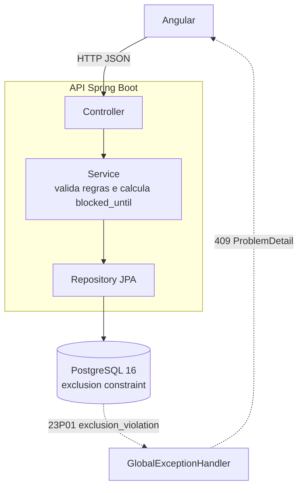
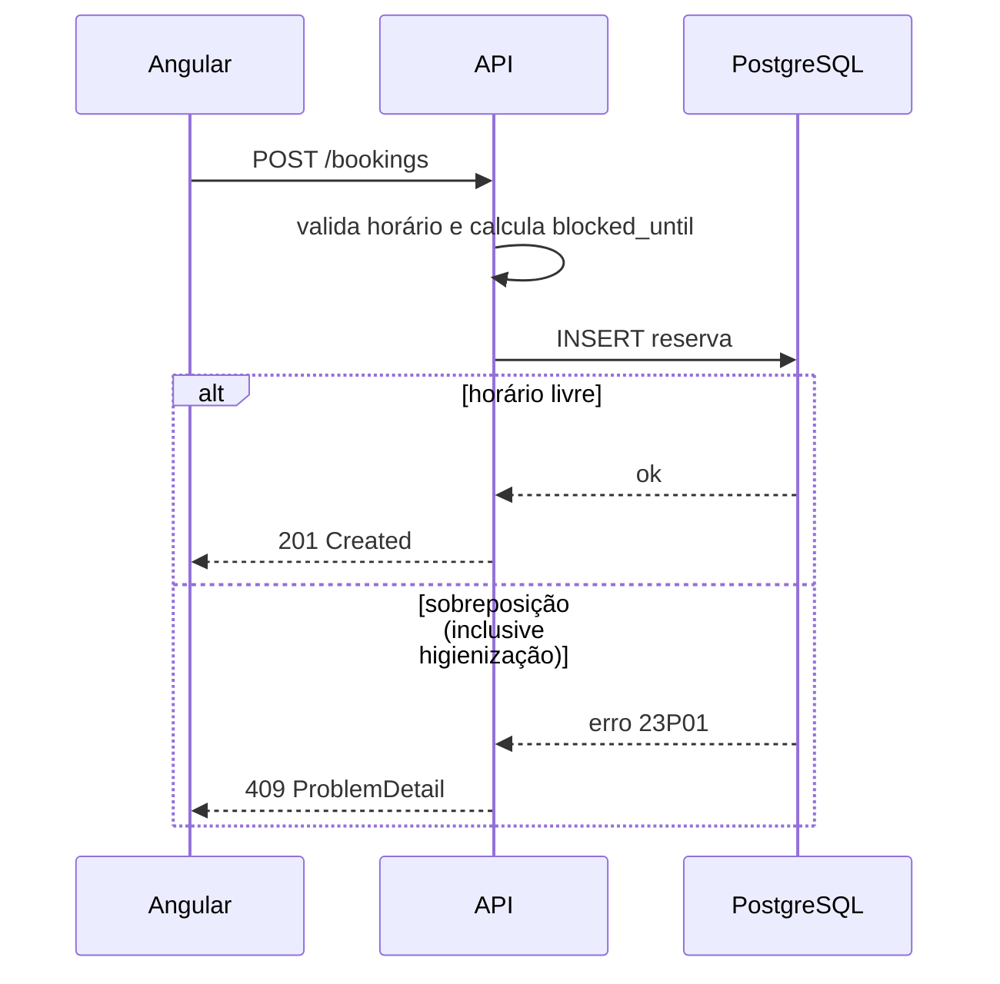

# Arquitetura e decisões técnicas

## Visão geral



O service faz uma checagem prévia só para dar uma mensagem amigável. Quem garante a regra, mesmo com requisições simultâneas, é a *exclusion constraint* do banco.



## Decisões técnicas

**Sobreposição resolvida no banco, não na aplicação.** Verificar "tem conflito?" e depois inserir tem corrida: duas requisições simultâneas passam na checagem. A tabela `bookings` tem uma *exclusion constraint*:

```sql
EXCLUDE USING gist (
    room_id WITH =,
    tstzrange(start_time, blocked_until) WITH &&
) WHERE (status = 'CONFIRMED');
```

`blocked_until` é o fim da reserva mais a higienização da sala, calculado no servidor (o cliente nunca o envia). A faixa que conta é `start_time` até `blocked_until`, então a higienização também bloqueia. Reservas canceladas ficam fora do `WHERE` e liberam o horário. A violação vira `409` na API. Detalhes em [`docs/specs/sobreposicao-higienizacao.md`](specs/sobreposicao-higienizacao.md).

**N+1 na listagem de reservas.** Cada linha mostra nome da sala e do profissional; carregar `room` e `professional` de forma preguiçosa disparava uma query por linha (7 statements para uma página de 5 reservas). O `@EntityGraph(attributePaths = {"room", "professional"})` em `BookingRepository` traz tudo num join e o teste `BookingListTest` agora exige no máximo 2 statements (a página e a contagem).

**Erros em `ProblemDetail`, em português.** Um `GlobalExceptionHandler` converte regras de negócio (409), entrada inválida (400) e não encontrado (404) no formato RFC 9457, com a mensagem pronta para o front mostrar:

```json
{ "title": "Conflict", "status": 409, "detail": "A sala já está reservada ou em higienização nesse horário", "instance": "/bookings" }
```

**Sem dados de paciente.** O sistema reserva salas, não atendimentos: não existe entidade de paciente. A reserva guarda só o profissional, a sala, o horário e uma finalidade em texto livre. Isso mantém o projeto fora do escopo de dados sensíveis de saúde; a finalidade não deve receber nomes de pacientes.

**Testcontainers para o que depende do Postgres.** A constraint usa `tstzrange` e `btree_gist`, que H2 não tem. O `BookingOverlapConstraintTest` sobe um PostgreSQL 16 real e prova que a constraint rejeita sobreposições, inclusive dentro da janela de higienização.

**Horários em UTC na API, fuso da clínica no front.** A API trafega `Instant`; o horário comercial e a exibição usam o fuso da clínica (-03:00).
