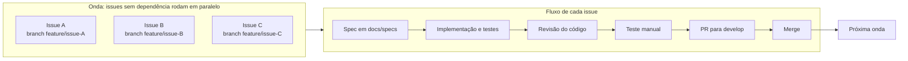

# Como foi desenvolvido

O projeto foi quebrado em issues pequenas do GitHub e resolvido em ondas paralelas: as issues sem dependência entre si rodavam ao mesmo tempo, cada uma na sua branch (`feature/issue-N`, a partir de `develop`) e com banco e portas próprios, para não haver conflito.

O fluxo de cada issue:

1. **Spec primeiro.** Regras de negócio e critérios de aceite escritos em [`docs/specs`](specs) (a partir de um template) antes do código.
2. **Implementação com testes**, no menor escopo que atende a issue.
3. **Revisão do código** e **teste manual** da funcionalidade rodando (API com `curl`, telas abertas ao lado do mockup em [`docs/design`](design/direcao-a), no desktop e no celular) antes de abrir o PR.
4. **PR para `develop`** com resumo e casos testados; merge só depois da validação.

Agentes de IA foram usados como ferramenta de implementação e revisão dentro desse processo. As decisões de produto, as specs e a validação final são humanas, e os commits e PRs são descritivos, sem atribuição de autoria a ferramentas.
